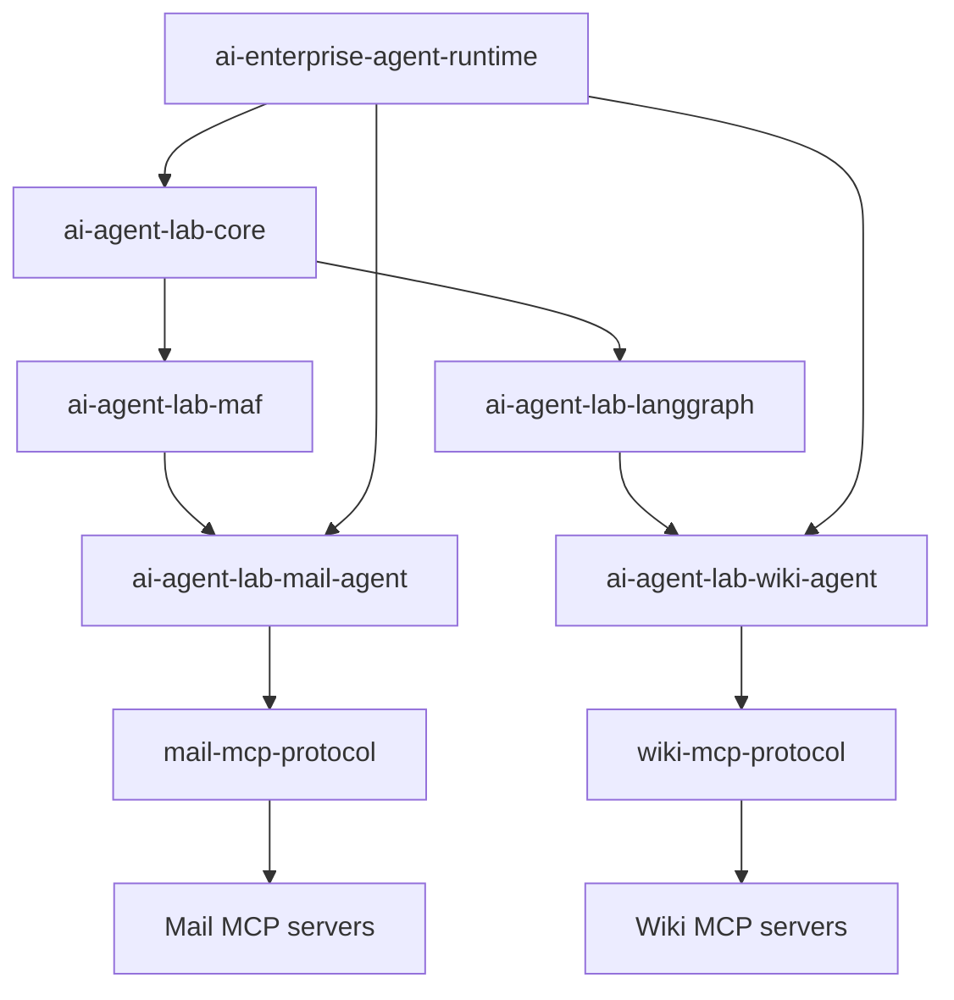
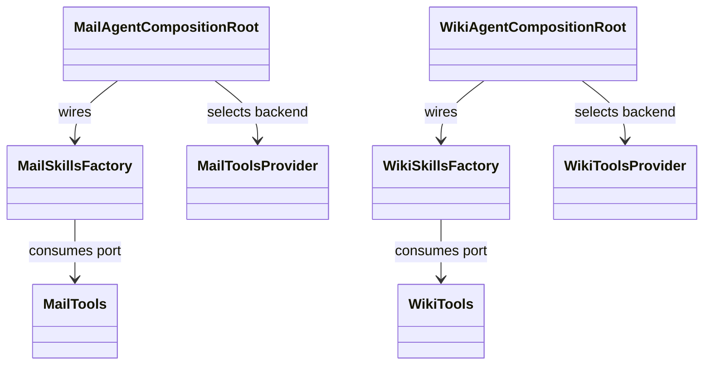

# Architecture and distributions

## Dependency direction

The repository ships ten independently buildable Python distributions. Mail
uses Microsoft Agent Framework, Wiki uses LangChain/LangGraph, and the MCP
servers are separate processes. Agent distributions share core configuration
and the external `ai-enterprise-agent-runtime`; they do not import each other's
framework adapter.

The graph is a responsibility map; consult each `pyproject.toml` for exact
extras and version constraints. `scripts/install.py` encodes environment
membership and dependency install order. Keep framework packages out of the
shared core and use one virtual environment per agent deployment.

## Layer rule

Within an agent, the composition root constructs concrete dependencies. Skills
depend on domain ports and runtime contracts. MCP dialects implement the
domain ports. MCP server packages depend on wire protocol packages and never
import `ai_agent_lab`.

`tests/architecture/test_distribution_boundaries.py` enforces package and
layer constraints. The [repository structure specification](../../spec/architecture/repository-structure.md)
lists each distribution and its role.

Useful source: [`agents/`](../../agents/), [`mcp-servers/`](../../mcp-servers/),
and [`scripts/install.py`](../../scripts/install.py).
