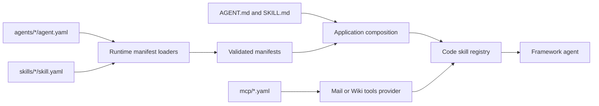
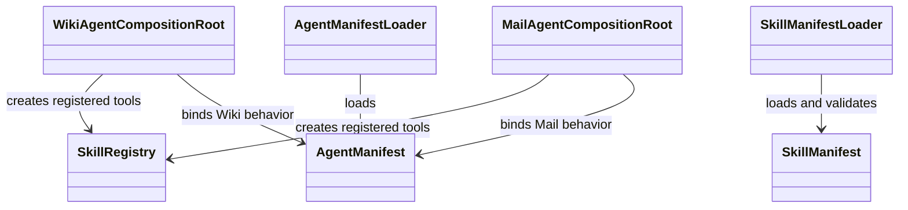

# Delivered configuration

## Configuration ownership

`config/` contains agent manifests, skill manifests and prompt Markdown, MCP
bindings, and deployment configuration. Runtime loaders validate the versioned
YAML manifest structures. Composition roots then bind the delivered entries
to code-owned skills and apply application policy. Markdown prompt files are
loaded separately from YAML schema validation.

The manifest is not the implementation. A capability absent from the code
registry cannot be created by adding YAML. Mail and Wiki also filter
capabilities that the selected MCP binding does not provide. Their security
floors reject configurations that weaken required write protections.

## Change procedure

When adding a skill, update its typed input/result and implementation, delivered
`skill.yaml` and `SKILL.md`, the agent's `agent.yaml`, registry/composition,
tests, and user docs. When changing the accepted YAML shape, update the runtime
schema and its tests in the runtime repository too.

Sources: [`config/agents`](../../config/agents/),
[`config/skills`](../../config/skills/), and [`config/mcp`](../../config/mcp/).
Tests: [delivered configuration](../../tests/integration/test_delivered_configuration.py),
[delivered security posture](../../tests/integration/test_delivered_posture.py),
and [capability exposure](../../tests/integration/test_capability_exposure.py).

See [configuration specification](../../docs/configuration.md),
[Mail agent specification](../../spec/agents/mail-agent.md),
[Wiki agent specification](../../spec/agents/wiki-agent.md), and
[MCP design](../../spec/integrations/mcp-design.md).
