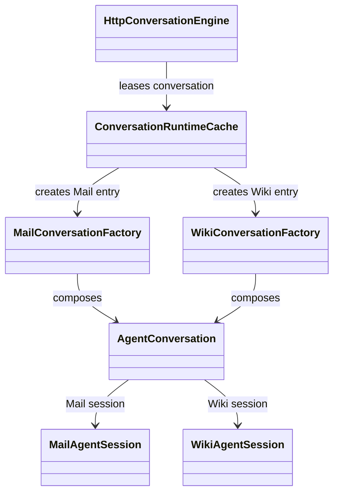
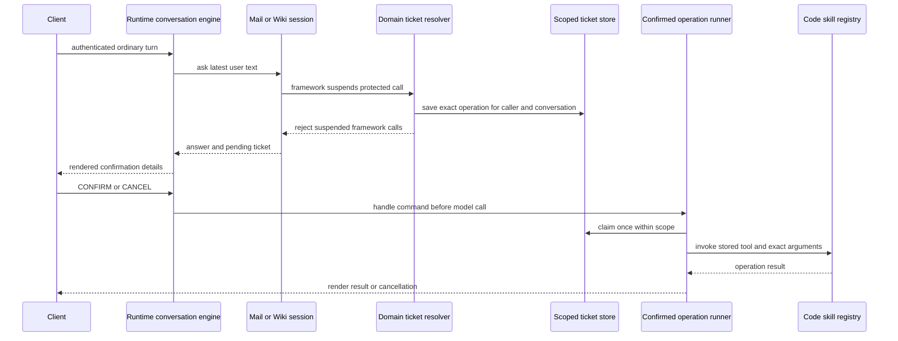

# Conversations and approvals

## Conversation composition

The HTTP entrypoint builds a turn from the authenticated principal, conversation
ID, and latest user message. The runtime cache creates or reuses a typed local
conversation. `MailConversationFactory` and `WikiConversationFactory` compose
the domain runtime, framework session, ticket store, confirmed-operation
runner, and pending-action renderer.

The factories are the advanced application composition point. They receive a
verified principal, pass it into the composition root, and close the runtime's
MCP provider when a cached conversation is retired. Do not let request body
history choose or overwrite server-owned framework state.

## Two approval levels

Application tickets handle a person confirming an operation on a later HTTP
turn. Framework interrupts handle a tool call suspended during one model
invocation. The runtime provides generic ticket and bounded-loop mechanics;
this repository provides the Mail and Wiki resolvers, presenters, and ledger
cleanup behavior.

Mail resumes Microsoft Agent Framework session state; Wiki resumes LangGraph
state through its thread ID and resume command. Keep framework mechanics in the
respective adapters, and keep confirmation meaning and display in the domain.

Source: [`Mail conversation factory`](../../agents/mail/src/ai_agent_lab/mail/application/entrypoints/conversation.py),
[`Wiki conversation factory`](../../agents/wiki/src/ai_agent_lab/wiki/application/entrypoints/conversation.py),
and domain session adapters under each agent's `application/session.py`.
Tests: [conversation engine](../../tests/integration/test_conversation_engine.py),
[Wiki conversation engine](../../tests/integration/test_wiki_conversation_engine.py),
[confirmation ticket flow](../../tests/integration/test_confirmation_tickets_flow.py),
and [Wiki ticket approval](../../tests/unit/wiki/test_wiki_ticket_approval.py).

See [Mail](../../spec/agents/mail-agent.md), [Wiki](../../spec/agents/wiki-agent.md),
and the runtime's [approval specification](https://github.com/ygo74/ai-enterprise-agent-runtime/blob/main/spec/runtime/human-approval.md).
