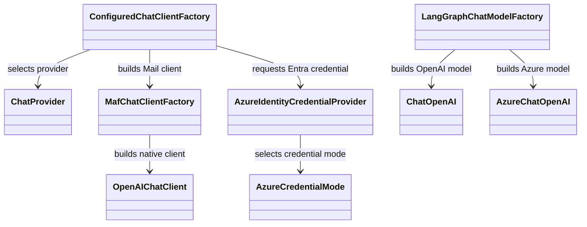
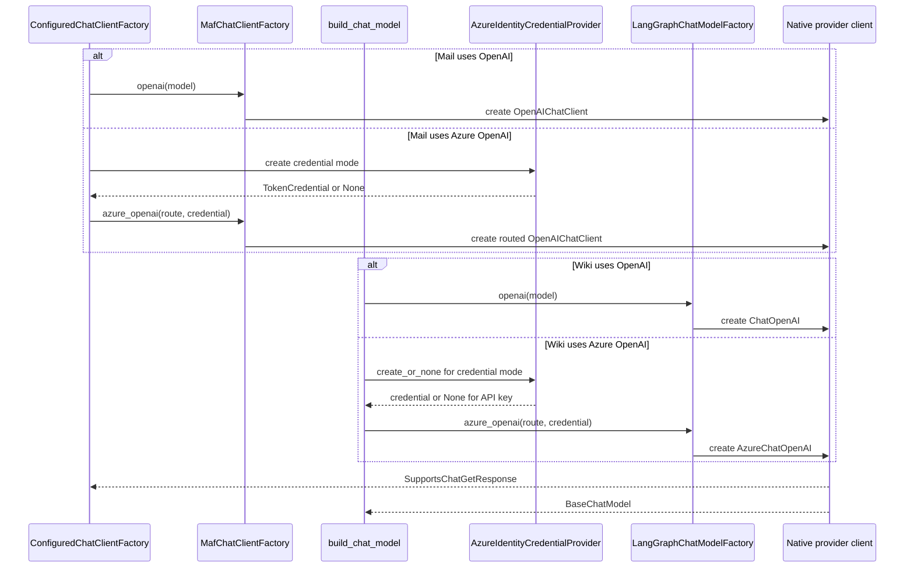

# Shared core services and model providers

`ai_agent_lab.core` contains the settings and helpers shared by the applications:
chat provider selection, Azure credential creation, and logging setup. It does
not depend on either agent framework. Framework-specific client construction
stays in the MAF and LangGraph adapter distributions.

## Model client construction

Both applications support OpenAI and Azure OpenAI. API key mode leaves key
resolution to the framework client. Entra modes use `AzureIdentityCredentialProvider`;
the credential object is passed to the native client and its token is not
handled by application code. The `azure-identity` import is deferred so an
OpenAI or API-key deployment does not require that optional package.

The Mail composition uses `ConfiguredChatClientFactory`. Wiki constructs its
model in `build_chat_model()` using `LangGraphChatModelFactory`. Keep their
provider settings aligned, and keep secrets out of settings models and logs.

## Logging

`setup_logging()` configures application loggers in `ai_agent_lab.core` and
updates existing handlers when the host configured them first. A host may
provide handlers and a default level. Do not add provider payloads or
credentials to startup logs.

Sources: [`agents/core`](../../agents/core/),
[`Mail chat client composition`](../../agents/mail/src/ai_agent_lab/mail/bootstrap/chat_client.py),
[`Wiki chat model construction`](../../agents/wiki/src/ai_agent_lab/wiki/adapters/cli/entrypoint.py),
and [MAF client factory](../../agents/maf/src/ai_agent_lab/maf/chat_client.py).
Tests: [chat client selection](../../tests/integration/test_chat_client_selection.py)
and [logging configuration](../../tests/unit/test_logging_config.py).

See the [configuration guide](../../docs/configuration.md) and [system
specification](../../spec/README.md).
