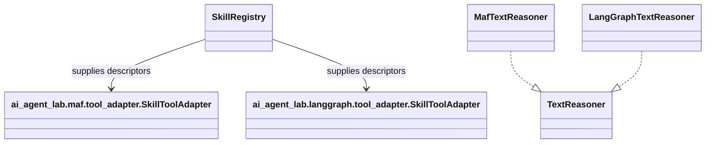
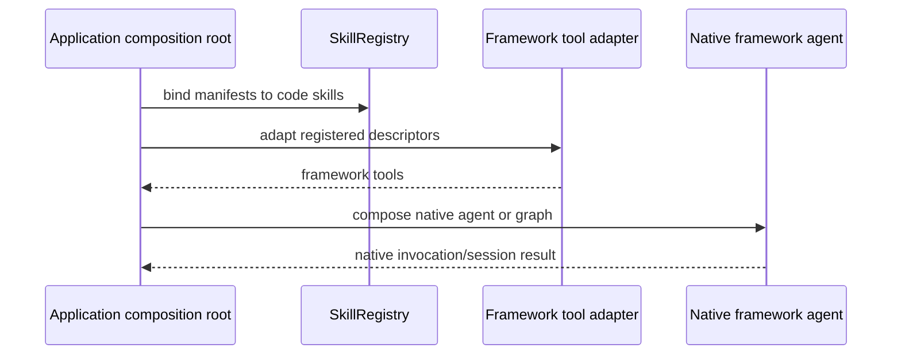

# Framework adapters

## Boundary

`ai_agent_lab.maf` and `ai_agent_lab.langgraph` translate application tool and
reasoning contracts into framework APIs. They do not own Mail or Wiki policy.
The Mail and Wiki composition roots build agents using their framework's
public APIs.

The concrete adapter packages are independent distributions. Mail's tools are
registered with Microsoft Agent Framework and use `AgentSession` for native
state. Wiki calls LangChain's `create_agent`, uses LangGraph checkpoint state,
and translates interrupts to runtime approval commands.

When adding another framework, add a sibling adapter distribution and tests.
Do not add framework imports to `agents/core`, Mail, or Wiki unless that
application specifically owns the integration. Keep approval translation
separate from the person's policy decision.

Source: [`agents/maf`](../../agents/maf/), [`agents/langgraph`](../../agents/langgraph/),
and composition roots in [`agents/mail`](../../agents/mail/) and
[`agents/wiki`](../../agents/wiki/).
Tests: [MAF tool registration](../../tests/integration/test_maf_tool_registration.py),
[LangGraph adapter](../../tests/unit/langgraph/test_langgraph_adapter.py),
and [Wiki LangGraph integration](../../tests/integration/test_wiki_agent_langgraph.py).

See the [agent design specification](../../spec/architecture/agent-design.md)
and [LangChain/LangGraph specification](../../spec/integrations/langchain-langgraph.md).
