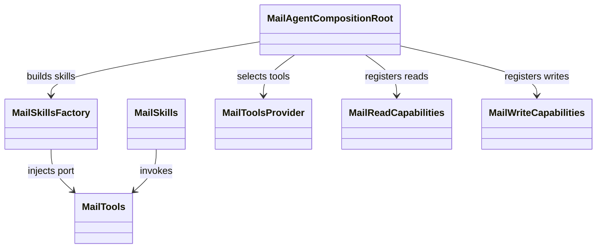
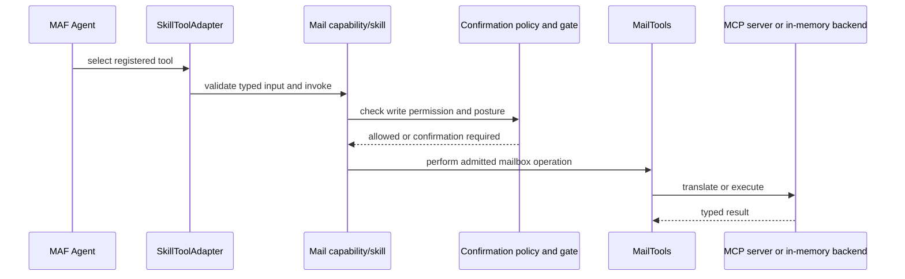

# Mail agent

## Domain structure

`ai_agent_lab.mail` owns mailbox models, permissions, tool ports, capabilities,
skills, and composition. Skill modules orchestrate deterministic checks and
typed tool calls. They do not call Gmail APIs. `MailToolsProvider` selects the
in-memory backend or a configured MCP dialect.

The composition root is the place to add or replace concrete collaborators.
Keep business behavior in skills/capabilities and keep framework conversion
in `ai_agent_lab.maf`.

## Skill and write path

Read operations retrieve typed data for summaries and analysis. Reply drafting
returns a `MailDraft`; sending is a separate write capability. Write posture
comes from the delivered operation descriptor and `MailSecurityFloor`.
Protected calls are gated by application policy even if invoked outside the
framework.

Use `tests/unit/skills/` for skill logic, `tests/unit/domain/` for domain
contracts, `tests/integration/test_delivered_posture.py` for delivered
security settings, and `tests/security/test_mail_security.py` for security
behavior.

Source: [`agents/mail/src/ai_agent_lab/mail`](../../agents/mail/src/ai_agent_lab/mail/).
See the [Mail specification](../../spec/agents/mail-agent.md),
[HTTP integration guide](../../docs/mail-agent-http.md), and
[Mail user guide](../../docs/mail-agent.md).
