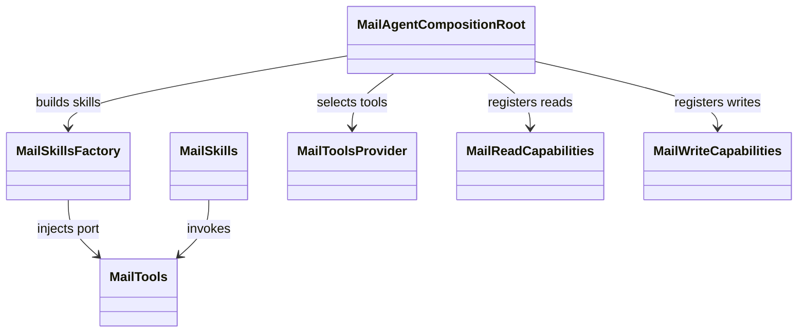
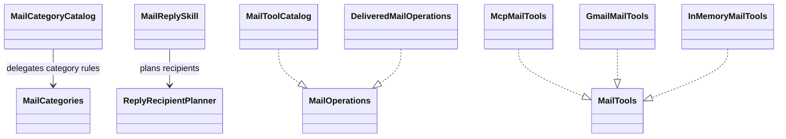
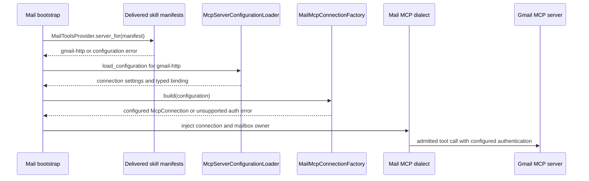
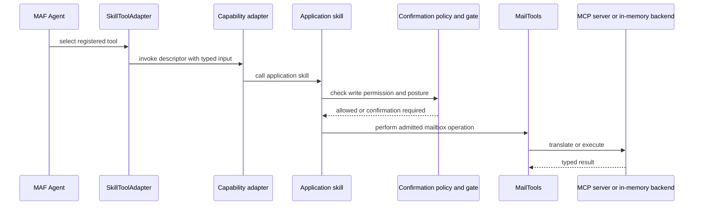

# Mail agent

## Layer ownership

`ai_agent_lab.mail` owns mailbox models, permissions, tool ports, capabilities,
skills, and composition. Skill modules orchestrate deterministic checks and
typed tool calls. They do not call Gmail APIs. `MailToolsProvider` selects the
in-memory backend or a configured MCP dialect.

Mail uses five layers. This is a progressive Mail-only reorganisation: it does
not change mailbox behavior, Wiki, or the shared runtime.

| Layer | Owns | Does not own |
|---|---|---|
| `domain/` | Models, errors, enums, permissions, origins, operation names, `ReplyRecipientPlanner`, `MailCategories`, and `MailSecurityFloor` | Tool ports, prompt wording, frameworks, or transports |
| `application/` | Tool and storage ports, skills, coded operation metadata, semantic tool errors, capability identifiers, and confirmation meaning | Concrete configuration, MCP codecs, framework sessions, or HTTP/CLI hosts |
| `infrastructure/` | Configuration readers, delivered operation descriptors, MCP dialects, and in-memory implementations | Skill orchestration or model-facing capability bindings |
| `adapters/` | Capability DTOs, descriptors, converters and renderers; CLI, HTTP and Mail-specific MAF integration | Mail business rules |
| `bootstrap/` | Concrete factories, composition, chat clients, tool provider, skill assembly, and conversation/service wiring | Reusable domain rules |

Dependencies point inward. Domain code does not import outer Mail layers.
Application code uses domain code and approved runtime contracts, never a
framework, transport, infrastructure implementation, adapter, or bootstrap
module. Infrastructure implements application ports. Adapters call application
skills; bootstrap selects and connects concrete collaborators.
The separately distributed `ai_agent_lab.maf` remains the generic MAF adapter.

There is one deliberate outer-edge exception:
[`adapters/maf/session.py`](../../agents/mail/src/ai_agent_lab/mail/adapters/maf/session.py)
imports `MailAgentRuntime` from bootstrap to attach Mail collaborators to
`AgentFrameworkSession`. This session integration reference is not permission
for application code to depend on bootstrap.

## Domain and application contracts

[`application/ports/`](../../agents/mail/src/ai_agent_lab/mail/application/ports/)
contains `MailTools`, `DraftStore`, `MailboxOwnerDirectory`, and `MailOperations`.
[`application/operations.py`](../../agents/mail/src/ai_agent_lab/mail/application/operations.py)
contains `MailToolCatalog`, the coded operation metadata.
`DeliveredMailOperations` in
[`infrastructure/configuration/operations.py`](../../agents/mail/src/ai_agent_lab/mail/infrastructure/configuration/operations.py)
reads the delivered posture through the `MailOperations` contract.
Semantic tool failures live in `application/errors.py`; configuration failures
use `MailAgentConfigurationError` in `infrastructure/configuration/errors.py`.

[`application/skills/bundle.py`](../../agents/mail/src/ai_agent_lab/mail/application/skills/bundle.py)
contains the `MailSkills` bundle. `MailCategoryCatalog` keeps classification
prompt wording in application skills and delegates membership, order, and
fallback rules to domain `MailCategories`. `ReplyRecipientPlanner` is a domain
service. Confirmation presentation and subject lookup live under
`application/confirmations/`; `targets.py` defines the shared
`housekeeping_target`. Capability identifiers live in `application/capability_names.py`.

## MCP dialect ownership

`MAIL_AGENT_MODE` chooses the mock or MCP backend. In MCP mode, Mail bootstrap
calls `MailToolsProvider.server_for(manifest)` to select one shared server from
the `mcp_server` references of skills that declare `mcp_tools`.
These references must be present and equal; missing or conflicting references
fail configuration. The delivered skills name `gmail-http`. Environment
variables do not select or override that server.

The shared runtime's `McpServerConfigurationLoader` owns YAML connection
settings: authentication, headers, `request_timeout_seconds`, transport and
network options. Mail infrastructure loads that configuration and retains its
typed tool binding and dialect registry. Keep credentials out of skills and
domain models; do not recreate runtime connection settings in Mail.

[`load_configuration`](../../agents/mail/src/ai_agent_lab/mail/infrastructure/mcp/configuration.py)
loads the selected runtime YAML with Mail's typed tool names and error category.
Bootstrap passes the selected server string to
[`MailToolsProvider`](../../agents/mail/src/ai_agent_lab/mail/bootstrap/mail_tools_provider.py).
[`MailMcpConnectionFactory`](../../agents/mail/src/ai_agent_lab/mail/infrastructure/mcp/connection.py)
applies the resolved timeout, headers and network options to `McpConnection`.
OAuth construction delegates to the runtime's `McpOAuthProviderFactory`.
API-key authentication uses the runtime-resolved header, not a Mail bearer
provider. `delegatedOAuth` is explicitly rejected because Mail has no delegated
token source. The old Mail MCP settings, OAuth module and bearer module are
removed; do not recreate compatibility paths.

Only designated YAML secret references resolve environment variables. In the
local HTTP binding, `${MAIL_MCP_HTTP_AUTHORIZATION}` contains the complete
`Bearer <shared-secret>` value; the server checks the raw
`MAIL_MCP_HTTP_TOKEN`. `GMAIL_OAUTH_*` and Google tokens belong only to that
server. This migration changes client configuration, not the server API,
mailbox authorization, or the Mail-only layer boundaries.

Native payload mapping and error decoding live under `infrastructure/mcp/native/`.
Native decoding reuses `mail_mcp.protocol.errors.decode` and translates wire
failures into application errors. Google payload, query and error handling stay
under `infrastructure/mcp/google/` and do not depend on the native protocol extra.
The dialect registry imports the native client lazily when it is selected.
Keep a new dialect behind `MailTools`; do not move wire details into skills.

## Skill and write path

Read operations retrieve typed data for summaries and analysis. Reply drafting
returns a `MailDraft`; sending is a separate write capability. Write posture
comes from the delivered operation descriptor and `MailSecurityFloor`.
Protected calls are gated by application policy even if invoked outside the
framework.

Use `tests/unit/skills/` for skill logic, `tests/unit/domain/` for domain
contracts, `tests/integration/test_delivered_posture.py` for delivered
security settings, and `tests/security/test_mail_security.py` for security
behavior.

Source: [`agents/mail/src/ai_agent_lab/mail`](../../agents/mail/src/ai_agent_lab/mail/).
See the [Mail specification](../../spec/agents/mail-agent.md),
[HTTP integration guide](../../docs/mail-agent-http.md), and
[Mail user guide](../../docs/mail-agent.md).

## Entry points

Use `python -m ai_agent_lab.mail.adapters.cli`,
`ai_agent_lab.mail.bootstrap.service:build_app` for Uvicorn, and
`ai_agent_lab.mail.adapters.maf.native:create_agent` for native hosting.
The console script targets `adapters.cli.entrypoint:main`; the Mail Docker host
uses `bootstrap.service:build_app`.

Authorisation and discovery use `python -m ai_agent_lab.mail.adapters.cli.authorise`
and `python -m ai_agent_lab.mail.adapters.cli.discover`.
Their `--server` option selects a runtime YAML file; `authorise` defaults to
`gmail` and uses its YAML OAuth configuration. This utility selection does not
override the agent's skill references.
Discovery uses `load_configuration` and `MailMcpConnectionFactory` too.
Authorisation reads scopes and the token path from YAML; `gmail.yaml` sets
`request_timeout_seconds: 600` to allow time for browser consent.
There are no executable entrypoints or compatibility wrappers under `application/`.
