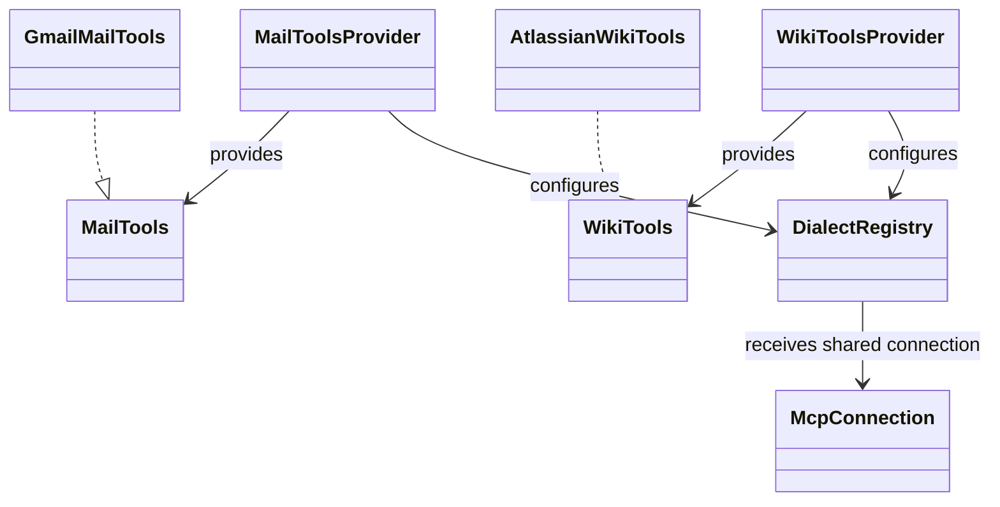
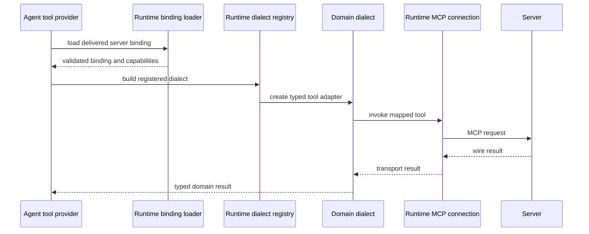

# MCP clients and dialects

## Client boundary

Mail and Wiki skills depend on `MailTools` and `WikiTools`. Providers select an
in-memory implementation or an MCP implementation. The shared runtime loads
and validates a binding, manages stdio or streamable-HTTP connections, and
selects an application-registered dialect. A dialect maps domain inputs and
outputs to a server's tool names and payloads.

The provider receives the application's settings and user identity. Wiki may
resolve caller-specific authorization headers and removes write capabilities
in read-only mode. Mail selects its configured OAuth or server credential
flow. Secret resolution, capability policy, error mapping, and domain models
stay in the application.

## Adding a server dialect

1. Implement the relevant domain port with strict input and output mapping.
2. Convert transport and payload errors to the agent's typed error hierarchy.
3. Register a factory under a stable dialect name.
4. Add or update a delivered MCP binding with only the tools the server
   actually exposes.
5. Add unit coverage for payload mapping and capability filtering.

Do not add provider SDKs to skills or framework adapters. Do not treat a
declared tool as an authorization grant. Keep returned free text marked as
untrusted content before reasoning uses it.

Sources: [Mail MCP adapters](../../agents/mail/src/ai_agent_lab/mail/mcp/),
[Wiki MCP adapters](../../agents/wiki/src/ai_agent_lab/wiki/mcp/),
[Mail provider](../../agents/mail/src/ai_agent_lab/mail/application/mail_tools_provider.py),
and [Wiki provider](../../agents/wiki/src/ai_agent_lab/wiki/application/wiki_tools_provider.py).
Tests: [Mail dialect registry](../../tests/unit/test_mail_dialect_registry.py),
[Atlassian dialect](../../tests/unit/wiki/test_atlassian_dialect.py),
[Mail MCP contract](../../tests/contract/test_mcp_mail_tools_contract.py),
and [connection contract](../../tests/contract/test_mcp_connection.py).

See [MCP client and tool-port design](../../spec/integrations/mcp-design.md)
and the [runtime MCP API specification](https://github.com/ygo74/ai-enterprise-agent-runtime/blob/main/spec/mcp/client-and-server.md).
