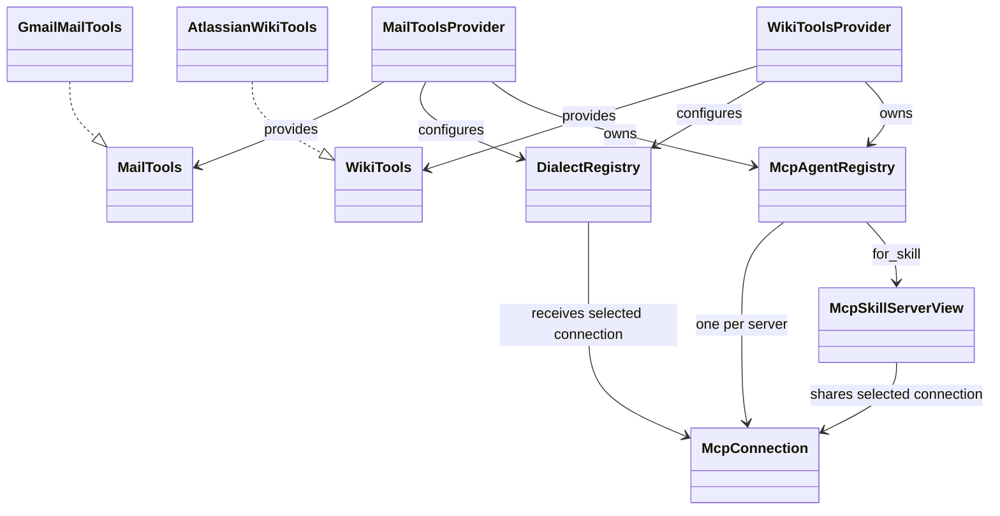
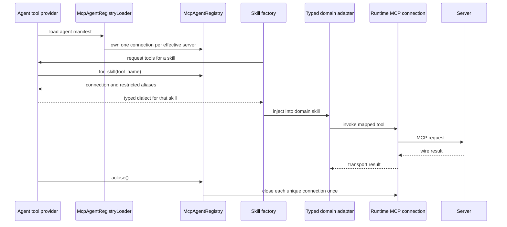

# MCP clients and dialects

## Client boundary

Mail and Wiki skills depend on `MailTools` and `WikiTools`. Providers select an
in-memory implementation or an MCP implementation. The shared runtime loads
and validates a binding, manages stdio or streamable-HTTP connections, and
selects an application-registered dialect. A dialect maps domain inputs and
outputs to a server's tool names and payloads.

The provider receives the application's settings and user identity. Wiki may
resolve caller-specific authorization headers and removes write capabilities
in read-only mode. Mail selects its configured OAuth or server credential
flow. Secret resolution, capability policy, error mapping, and domain models
stay in the application.

## Per-skill routing

An agent provider owns one `McpAgentRegistry` for its caller and execution
lifetime. `McpAgentRegistryLoader` resolves `skill.mcp_server` first, then
`agent.mcp_server`, and creates one lazy connection per distinct server.
`for_skill(tool_name)` returns a view with that connection and only the skill's
allowed tool aliases. The provider creates a typed dialect using this view;
reasoning skills receive their own selected adapter, not the first server found
in the manifest.

Some domain classes implement several manifest capabilities. Their operation
adapters route each operation to its matching manifest skill. For example,
getting a message and getting a thread can select different servers, even when
the same domain class implements both operations. A reasoning skill such as
`summarise_mail` instead keeps its own selection for all its declared reads.
Do not route by the remote tool name alone: two skills may declare the same
alias but select different servers.

Capability exposure must use the selected skill's aliases and binding, not
another server's capabilities. Caller identity, authorization and write
confirmation still apply. Closing the provider closes its registry and each
unique connection once. Do not share a provider across callers or let a skill
own or close a connection.

The examples withdraw a skill when its selected backend does not support every
alias declared by that skill. Providers exclude these skills before the runtime's
strict registry validation, and composition resolves their adapters lazily.
This allows partial backends (such as Atlassian without page history) to start
without advertising unavailable capabilities. An explicit call to a withdrawn
skill still fails; it never falls back to another server. Missing server names
or invalid server references remain configuration errors.

### Example for another agent

1. Put the common `mcp_server` in the agent manifest.
2. Add a skill override only when that skill needs another server, and declare
   its `mcp_tools` aliases.
3. Load the runtime registry once in the composition layer.
4. Use `for_skill(tool_name)` to select the connection and restrict the binding
   before creating the typed domain adapter.
5. Inject that adapter into the skill. Keep MCP details out of business code.
6. Derive exposed capabilities from the same scoped binding and close the
   registry at the end of the execution lifetime. Do not borrow capabilities
   from another skill's server.

A domain class may implement several manifest operations, such as reading a
message and reading a thread. Route each operation through its own manifest
skill, instead of injecting only the first operation's scoped adapter. Mail
uses [RoutedMailTools](../../agents/mail/src/ai_agent_lab/mail/bootstrap/routed_mail_tools.py)
for this case. A reasoning skill keeps its own scoped adapter for all its reads;
overriding `get_mail` must not also redirect `summarise_mail`. Keep registry
lifecycle checks active in saved adapters so they cannot reopen closed sessions.

For example, an agent default of `gmail-api` and a `get_mail` override of
`gmail-http` create two connections. Skills inheriting `gmail-api` share its
connection; `get_mail` uses the other connection. These names are existing Mail
bindings, not a requirement for future agents. Each future agent supplies its
own typed port, capability enum and dialect factories.

## Adding a server dialect

1. Implement the relevant tool port with strict input and output mapping.
   Mail's port is in `application/ports/mail_tools.py`; its implementations belong
   in `infrastructure/mcp/`.
2. Convert transport and payload errors to the agent's typed error hierarchy.
3. Register a factory under a stable dialect name.
4. Add or update a delivered MCP binding with only the tools the server
   actually exposes.
5. Add unit coverage for payload mapping and capability filtering.

Do not add provider SDKs to skills or framework adapters. Do not treat a
declared tool as an authorization grant. Keep returned free text marked as
untrusted content before reasoning uses it.

Sources: [Mail MCP adapters](../../agents/mail/src/ai_agent_lab/mail/infrastructure/mcp/),
[Wiki MCP adapters](../../agents/wiki/src/ai_agent_lab/wiki/infrastructure/mcp/),
[Mail provider](../../agents/mail/src/ai_agent_lab/mail/bootstrap/mail_tools_provider.py),
and [Wiki provider](../../agents/wiki/src/ai_agent_lab/wiki/bootstrap/wiki_tools_provider.py).
Tests: [Mail dialect registry](../../tests/unit/test_mail_dialect_registry.py),
[Atlassian dialect](../../tests/unit/wiki/test_atlassian_dialect.py),
[Mail MCP contract](../../tests/contract/test_mcp_mail_tools_contract.py),
and [connection contract](../../tests/contract/test_mcp_connection.py).

See [MCP client and tool-port design](../../spec/integrations/mcp-design.md)
and the [runtime MCP API specification](https://github.com/ygo74/ai-enterprise-agent-runtime/blob/main/spec/mcp/client-and-server.md).
