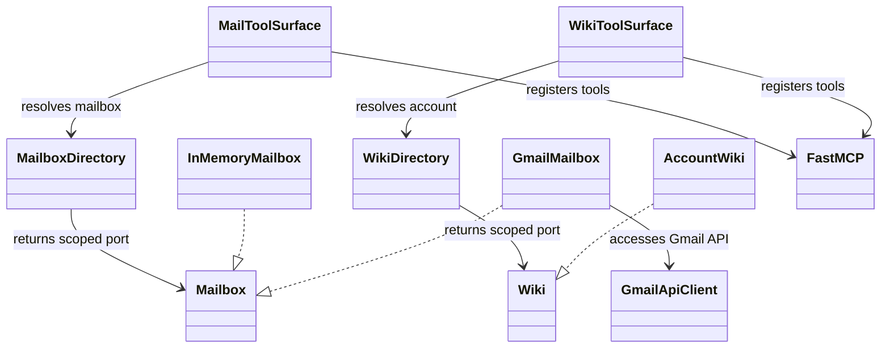
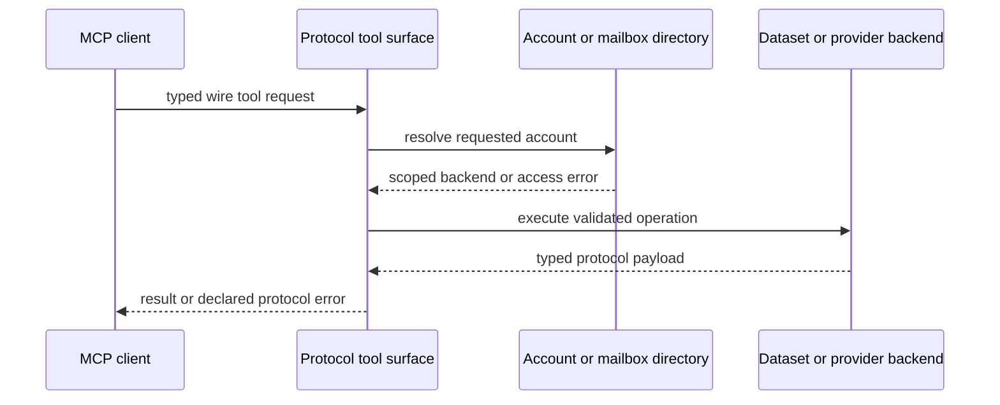

# MCP server distributions

## Server layers

Each server distribution depends on its wire protocol package and remains
independent of `ai_agent_lab`. The protocol package owns payloads, tool names,
error codes, and a reusable FastMCP surface. A reference server implements
that surface over a deterministic dataset. The Gmail distribution implements
the Mail contract against the Gmail API. Wiki production integrations can use
an external compatible server through the Wiki agent's Atlassian dialect.

## Request lifecycle

The server, not the agent, is the final boundary for mailbox/account access.
MCP HTTP hosting uses the shared runtime MCP server package; stdio remains a
local process transport. Keep authentication setup and data-source credentials
in the server process. Never import agent domain models into protocol modules.

Sources: [`mcp-servers/protocol`](../../mcp-servers/protocol/),
[`mcp-servers/gmail`](../../mcp-servers/gmail/),
[`mcp-servers/reference`](../../mcp-servers/reference/),
[`mcp-servers/wiki-protocol`](../../mcp-servers/wiki-protocol/), and
[`mcp-servers/wiki-reference`](../../mcp-servers/wiki-reference/).
Tests: [Mail server contract](../../tests/contract/test_mail_tools_contract.py),
[MCP wire contract](../../tests/contract/test_mcp_mail_tools_contract.py),
[server authentication](../../tests/security/test_mcp_server_authentication.py),
and [distribution boundaries](../../tests/architecture/test_distribution_boundaries.py).

See [MCP server hosting specification](../../spec/integrations/mcp-server-hosting.md)
and [Mail](../users/mail-mcp-servers.md) and
[Wiki](../users/wiki-mcp-servers.md) deployment guides.
