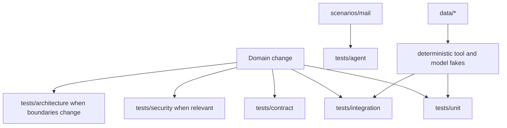

# Tests and scenarios

## Test layers

Use the narrowest test layer that proves the behavior, then add integration
coverage when a change crosses application boundaries. Tests use deterministic
tools, model fakes, or sample datasets unless the behavior specifically needs a
real provider.

| Area | What it protects |
|---|---|
| `tests/unit/` | Skills, models, policies, dialect mappings, and adapters |
| `tests/contract/` | Domain tool ports, MCP payloads, and HTTP provider shapes |
| `tests/integration/` | Composition, conversations, delivered capabilities, and framework flow |
| `tests/security/` | Identity, permissions, confirmation, and MCP server authentication |
| `tests/architecture/` | Distribution dependencies, layer direction, and server isolation |
| `tests/agent/` | End-to-end scenarios against the deterministic Mail dataset |

Scenario inputs live in `scenarios/`; sample mail and wiki content lives in
`data/`. Keep secrets and live provider credentials out of fixtures. Use
`tests/support/` fakes for framework behavior and avoid duplicating a fake
inside each test module.

For environment selection and repository quality commands, follow the root
[`README.md`](../../README.md) and the [installation guide](../../docs/deployment.md).
The [system specification](../../spec/README.md) links each domain's behavior.
