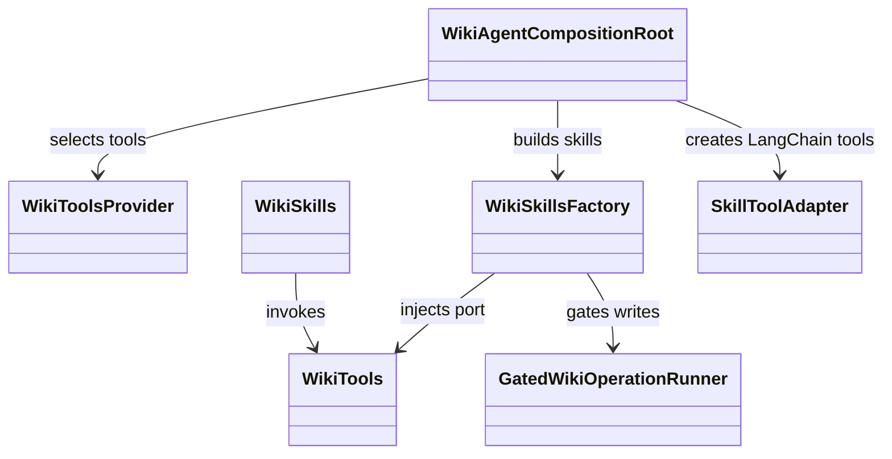
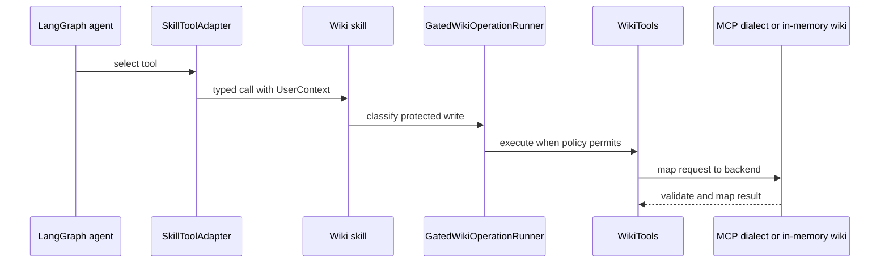

# Wiki agent

## Domain structure

`ai_agent_lab.wiki` owns page models, permissions, tool ports, capabilities,
skills, and graph composition. Skills use the `WikiTools` port and framework
neutral reasoning. They do not call Confluence directly. `WikiToolsProvider`
selects the in-memory backend or an MCP dialect and applies the delivered
capability binding.

The composition root builds the LangChain graph and attaches
`HumanInTheLoopMiddleware`. Keep Wiki policy, graph composition, and
Atlassian-specific behavior in the Wiki domain. Runtime LangGraph execution
and HTTP hosting live in the shared runtime integration.

## Read, prepare, and write flow

Search returns references and short excerpts; skills read selected pages as a
separate operation. Analysis skills ground answers in retrieved content.
`draft_page_content` saves an application-owned draft reference. Publish or
update resolves the stored body and checks expected version where applicable.
The delivered capability set and `WIKI_MCP_READ_ONLY` filter tools before the
model receives them.

Tests: [Wiki skills](../../tests/unit/wiki/test_wiki_skills.py),
[write skills](../../tests/unit/wiki/test_wiki_write_skills.py),
[MCP client](../../tests/unit/wiki/test_wiki_mcp_client.py),
[Wiki security](../../tests/security/test_wiki_security.py), and
[LangGraph integration](../../tests/integration/test_wiki_agent_langgraph.py).

Source: [`agents/wiki/src/ai_agent_lab/wiki`](../../agents/wiki/src/ai_agent_lab/wiki/).
See the [Wiki specification](../../spec/agents/wiki-agent.md),
[LangChain/LangGraph contributor page](framework-adapters.md), and
[Wiki user guide](../../docs/wiki-agent.md).
