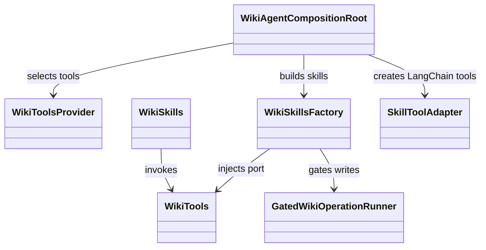
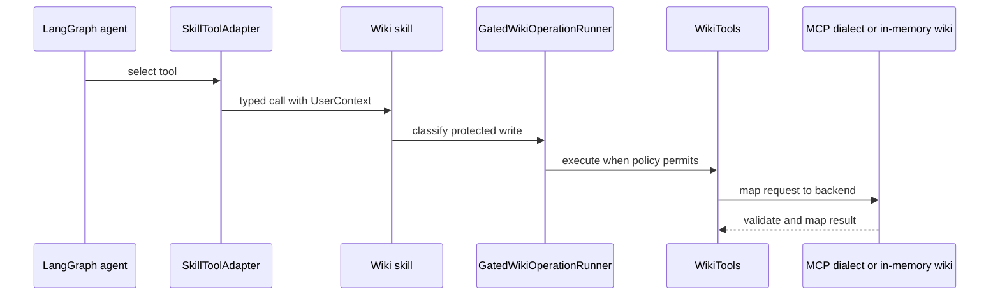

# Wiki agent

## Domain structure

`ai_agent_lab.wiki` owns page models, permissions, tool ports, capabilities,
skills, and graph composition. Skills use the `WikiTools` port and framework
neutral reasoning. They do not call Confluence directly. `WikiToolsProvider`
selects the in-memory backend or per-skill MCP dialects and applies the delivered
capability bindings. In MCP mode, its runtime registry owns one connection per
referenced server. Skills inherit the agent's `mcp_server` unless they declare
an override. The factory injects the selected, alias-scoped adapter into each
skill; it does not select one global server. See
[per-skill routing](./mcp-clients.md#per-skill-routing) for the reusable pattern.

`DocumentationSearchSkill` is grouped: it implements `search`, `get_page`,
`get_children`, `list_spaces`, `get_comments`, and `get_history`, and each of
those can be withdrawn or routed to a different server independently. The
factory therefore injects `RoutedWikiTools` into it, the same operation router
every standalone write already uses, instead of one fixed per-skill adapter -
mirroring how the Mail agent routes its own grouped operations. Reasoning
skills (`summarise_page`, `answer_from_wiki`, `assess_page_freshness`,
`draft_page_content`) keep their own fixed, alias-scoped adapter for their
whole call instead, because every read inside one reasoning call must stay on
the one server that skill declares. A skill the manifest withdraws is still
built, against `RoutedWikiTools` wrapping a resolver that raises the same
explicit `McpBindingError` on first use; there is one router class for both
cases, not a second full-port stand-in that repeats every `WikiTools` method
solely to discard parameters and raise.

[WikiMcpRegistryLoader](../../agents/wiki/src/ai_agent_lab/wiki/infrastructure/mcp/registry.py)
resolves stdio environment variable references before creating connections.
When the server declares no YAML authentication, it preserves Wiki's legacy
caller headers and timeout; explicit YAML authentication uses the runtime's
configured authentication instead.

`WikiToolsProvider` takes an optional `credentials: WikiUserCredentials` for a
genuinely caller-bound source - one secret per authenticated subject, resolved
request by request. Without one, the fixed `WIKI_MCP_USER_ACCOUNT` /
`WIKI_MCP_USER_SECRET` legacy header is admitted only for the one subject
named by `WikiAgentSettings.user_id`, never the current request's caller: a
deployment-wide credential is not per-user just because its authorization
scheme is non-`none`. `_explicit_context()` keeps the dialect's account-owner
guard bound to that same configured subject unless an injected,
genuinely-caller-bound credential source supplied the header instead, and a
subject with no credential in that source is refused rather than falling back
to the deployment account. `for_principal()` clones the composition root for a
new caller and preserves the injected credential source across that clone, so
every per-caller runtime still resolves through the one configured source.
Explicit YAML-authenticated servers are unaffected: that authentication is
owned by the runtime connection, not this legacy header path.

The composition root builds the LangChain graph and attaches
`HumanInTheLoopMiddleware`. Keep Wiki policy, graph composition, and
Atlassian-specific behavior in the Wiki domain. Runtime LangGraph execution
and HTTP hosting live in the shared runtime integration.

## Read, prepare, and write flow

Search returns references and short excerpts; skills read selected pages as a
separate operation. Analysis skills ground answers in retrieved content.
`draft_page_content` saves an application-owned draft reference. Publish or
update resolves the stored body and checks expected version where applicable.
The delivered capability set and `WIKI_MCP_READ_ONLY` filter tools before the
model receives them.

Tests: [Wiki skills](../../tests/unit/wiki/test_wiki_skills.py),
[write skills](../../tests/unit/wiki/test_wiki_write_skills.py),
[MCP client](../../tests/unit/wiki/test_wiki_mcp_client.py),
[Wiki security](../../tests/security/test_wiki_security.py), and
[LangGraph integration](../../tests/integration/test_wiki_agent_langgraph.py).

Source: [`agents/wiki/src/ai_agent_lab/wiki`](../../agents/wiki/src/ai_agent_lab/wiki/).
See the [Wiki specification](../../spec/agents/wiki-agent.md),
[LangChain/LangGraph contributor page](framework-adapters.md), and
[Wiki user guide](../../docs/wiki-agent.md).
