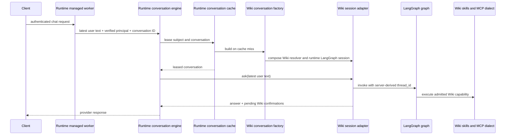

# LangChain and LangGraph in the Wiki agent

## Why this integration exists

The Wiki agent is built with LangChain's public `create_agent` API and LangGraph
checkpoint state. Its graph, Wiki tools, authorization rules, and confirmation
experience are application behavior. HTTP hosting, conversation cache,
provider-neutral output conversion, and bounded graph-interruption handling are
shared mechanics used by other applications too.

The Wiki application uses the runtime's native LangGraph session and managed
worker for those shared mechanics. This keeps the agent idiomatic to LangChain
while avoiding a second application-owned copy of generic HTTP and graph
execution plumbing.

## Ownership boundary

| Concern | Owner |
|---|---|
| Wiki prompts, skills, tool registry, graph, and model selection | `ai_agents` |
| Wiki permissions, confirmation policy, ticket resolver, ledger, and result rendering | `ai_agents` |
| Atlassian dialect, caller-specific MCP settings/headers, and read-only capability filtering | `ai_agents` |
| Neutral result/stream conversion and native LangGraph invocation | Runtime LangChain integration |
| Conversation cache, HTTP turn handling, authentication, discovery, readiness, and shutdown | Runtime managed worker and runtime agents package |

The runtime integration does not build the Wiki graph or authorize its tools.
The Wiki `conversation_factory` is the advanced worker extension point: it
assembles the Wiki runtime, ticket store, session adapter, confirmed-operation
runner, and pending-action renderer for one authenticated conversation.

## Request and conversation flow

The managed worker partitions cached conversations by authenticated subject and
conversation ID. The Wiki composition derives an opaque LangGraph `thread_id`
from the verified subject and conversation. The client supplies only the latest
message; server-managed graph state carries prior turns. Client-provided message
history is not replayed.

The current Wiki HTTP service exposes OpenAI Chat Completions. The runtime
binding also supports neutral streaming for consumers that configure a
streaming-capable surface; that does not mean the Wiki service currently
exposes streaming.

## Approval behavior

The graph uses Wiki's existing `HumanInTheLoopMiddleware` and interrupt table.
The runtime LangGraph session extracts pending actions and delegates each batch
to `WikiTicketApprovalResolver`. Wiki policy creates the person-facing
confirmation ticket and uses the ledger to preserve the approved operation.
The runtime enforces approval-question and total-turn limits and performs
bounded rejection cleanup when a turn is abandoned or exceeds its budget.

An approval command on a later HTTP request is handled by the generic
conversation engine before the graph is called. The confirmed-operation runner
claims the ticket within its caller and conversation scope and executes the
stored operation arguments. The model cannot rewrite the approved operation.
The resolver and ledger grant cleanup remain Wiki responsibilities.

## MCP behavior

The Wiki tools provider uses the runtime's generic binding loader, connection,
and dialect registry. Wiki code still resolves delivered configuration,
credentials and caller-specific HTTP headers, registers the Atlassian dialect,
and filters unavailable capabilities. Read-only deployments remove write
capabilities before they are exposed. The runtime validates generic transport
and tool mapping structure; it does not decide which Wiki operations a user may
perform.

## Constraints and acceptance

- A conversation is partitioned by verified identity and conversation ID in
  both the runtime cache and LangGraph checkpoint key.
- Only the latest user message is added for a turn; persisted graph state holds
  earlier turns.
- Wiki owns graph construction, authorization, ticket policy, tool admission,
  MCP credentials, and read-only filtering.
- The runtime owns reusable hosting and LangGraph invocation mechanics; failed,
  cancelled, or abandoned graph turns are not reused as healthy conversations.
- A confirmed operation is claimed once for its caller and conversation and
  runs from the arguments stored with its ticket.
- MCP bindings, connections, and dialect registration are shared APIs, while
  concrete Wiki tool mappings and policy remain local.

The runtime contracts are specified in its [LangChain/LangGraph integration](https://github.com/ygo74/ai-enterprise-agent-runtime/blob/main/spec/integrations/langchain-langgraph.md), [conversation and cache](https://github.com/ygo74/ai-enterprise-agent-runtime/blob/main/spec/runtime/pipelines-and-state.md), [approval](https://github.com/ygo74/ai-enterprise-agent-runtime/blob/main/spec/runtime/human-approval.md), and [MCP](https://github.com/ygo74/ai-enterprise-agent-runtime/blob/main/spec/mcp/client-and-server.md) specifications.

The application behavior is implemented in [Wiki composition](../../agents/wiki/src/ai_agent_lab/wiki/application/composition.py), [Wiki conversation factory](../../agents/wiki/src/ai_agent_lab/wiki/application/entrypoints/conversation.py), and [Wiki HTTP service](../../agents/wiki/src/ai_agent_lab/wiki/application/entrypoints/service.py).
