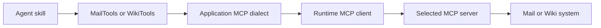

# MCP client and tool-port design

## Why this boundary exists

Mail and Wiki can use different MCP servers without making their skills depend
on a server's tool names or payload format. Each agent works through a typed
domain tool port. A concrete dialect translates between that port and the
selected server.

This separation lets a mock, a repository reference server, and an external
server serve the same application behavior. It also keeps framework SDKs and
provider-specific MCP payloads out of the skills.

## Responsibilities

| Part | Responsibility | Owner |
|---|---|---|
| `MailTools` and `WikiTools` | Typed operations that skills can call | Mail and Wiki applications |
| Domain dialect | Map tool names and payloads, validate results, translate failures, and apply domain capability filters | Mail or Wiki application |
| Binding, transport lifecycle, and dialect registry | Load and validate delivered server settings, connect, and select the dialect | Shared runtime MCP client |
| Wire protocol and server behavior | Expose MCP tools and reach a data source | MCP server distribution |

The runtime does not own Mail or Wiki domain models, credentials, capability
policy, or concrete dialects. Each application chooses its dialect, resolves
secrets and caller-specific authorization, and passes transport settings to
the runtime client. The Mail Agent Framework and Wiki LangChain/LangGraph
adapters use the same application tool ports; changing a framework does not
change the tool contract.

## Binding and call behavior

An application loads a binding for its selected server. The binding describes
the transport, dialect identifier, capabilities provided, and server tool
names. The runtime validates the generic structure and opens the configured
stdio or streamable-HTTP connection. The application registers dialect
factories and supplies the domain-specific configuration.

Before exposing tools to an agent, the application combines the binding's
available capabilities with its own policy. A missing remote tool is not
advertised. Wiki read-only mode removes write capabilities. The model can only
request an admitted operation; deterministic application checks and the source
system still decide whether that operation is allowed.

For each call, the dialect maps typed domain input to the server's wire input,
checks the returned payload, and maps it to the domain result. A missing tool,
unavailable server, or malformed response becomes a typed application error;
it is not treated as an empty or successful result. Tool results remain
untrusted content even when their structure is valid.

## Identity and security

Authentication and authorization are separate decisions. The application
derives the caller from its trusted request context, resolves any delegated
headers or credentials, and passes them to the configured connection. The
server or source system must enforce access to the caller's mailbox, pages, or
spaces. Application permissions and confirmation policy remain additional
checks for writes.

Credentials do not belong in prompts, domain tool arguments, or manifests.
Free text returned by a server is untrusted data. Neither a tool description
nor a binding grants permission to read or change source data.

## Acceptance

- Skills call typed Mail or Wiki ports and do not depend on MCP wire payloads.
- A concrete dialect validates and translates both requests and responses.
- A binding that omits a capability cannot expose that operation to the agent.
- Authorization and write confirmation are checked outside model-controlled
  text.
- Invalid payloads, unavailable tools, and connection failures remain visible
  as typed errors.

See the [Mail agent specification](../agents/mail-agent.md),
[Wiki agent specification](../agents/wiki-agent.md), and [MCP server hosting
specification](mcp-server-hosting.md). Shared binding, connection, and registry
behavior is described by the runtime's [MCP specification](https://github.com/ygo74/ai-enterprise-agent-runtime/blob/main/spec/mcp/client-and-server.md).
Application implementations live in [`agents/mail/.../infrastructure/mcp/`](../../agents/mail/src/ai_agent_lab/mail/infrastructure/mcp/),
[`agents/wiki/.../mcp/`](../../agents/wiki/src/ai_agent_lab/wiki/mcp/), and the
runtime MCP client provider factories.
